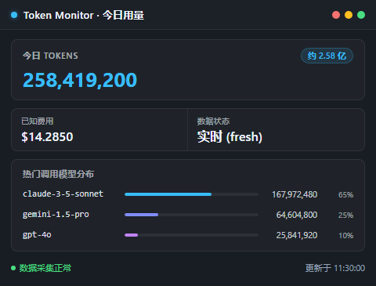
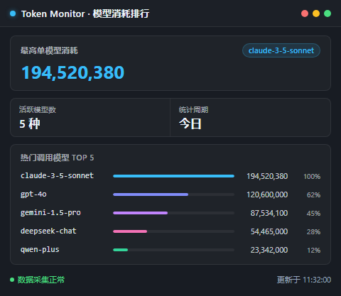

# OneBot 机器人网关 (onebot-monitor)

为 Token Monitor 提供基于 OneBot (v11) 协议的机器人网关扩展，实现跨平台的 Token 用量查询、原生暗黑卡片渲染、定时日报推送与超额告警订阅服务。

[Release v1.0.0](https://github.com/BYWled/token-monitor-plugin-onebot/releases) · [License: GPL-3.0](LICENSE) · [GitHub 仓库](https://github.com/BYWled/token-monitor-plugin-onebot) · [Gitee 镜像](https://gitee.com/BYWled/token-monitor-plugin-onebot) · [GitCode 镜像](https://gitcode.com/BYWled/token-monitor-plugin-onebot)



## Compatibility

- **Token Monitor**: 支持插件系统的版本（`tmApi: 1`，如 `>= 0.80.0`）
- **支持平台**: Windows (x64 / arm64)、macOS (Apple Silicon / Intel)、Linux (x64)
- **运行依赖**: 内置纯 Node.js 标准库与 RFC-6455 协议驱动，**零 npm 外部第三方依赖**。图片卡片渲染直接调用系统中已安装的 Chrome、Edge 或 Chromium 浏览器（主流桌面系统自带）。

## Install

### 方式一：通过 `.tmplugin` 插件包安装（推荐）

1. 前往 [GitHub Releases](https://github.com/BYWled/token-monitor-plugin-onebot/releases/tag/v1.0.0) 下载最新构建的 `onebot-monitor-1.0.0.tmplugin` 安装包。
2. 打开 Token Monitor 客户端，点击左下角 **设置 (Settings) ➜ 插件 (Plugins) ➜ 已安装 (Installed)**。
3. 点击右上角 **更多操作 (More actions) ➜ 导入插件包 (Import package)**，选择已下载的 `onebot-monitor-1.0.0.tmplugin`。
4. 查看安装包安全提示与代码权限，选择 **“信任、安装并启用 (Trust, install and enable)”** 即可运行；或选择 **“仅安装 (Install only)”** 保持未启用状态。
5. 本插件声明了 `defaults.background: true`，安装向导默认勾选“后台运行 (Background execution)”，确保客户端最小化到系统托盘时后台依然持续响应消息与定时推送。

### 方式二：从源码文件夹直接导入

1. 克隆或下载本仓库至本地：
   ```sh
   git clone https://github.com/BYWled/token-monitor-plugin-onebot.git
   ```
2. 打开 Token Monitor **设置 ➜ 插件 ➜ 已安装 ➜ 更多操作 ➜ 导入文件夹 (Import folder)**。
3. 选择本仓库根目录（或 `onebot-monitor` 目录），点击 **“信任、安装并启用”** 即可。

## Usage

### 指令速查（仅管理员）

在已配置管理员 QQ 的私聊或群聊中发送以下指令：

| 指令 | 别名 | 作用说明 | 格式示例 |
| :--- | :--- | :--- | :--- |
| `/token [图\|文]` | `/用量` | 查询今日 Token 消耗与已知费用，支持附加 `图` 或 `文` | `/token`、`/token 图`、`/token 文` |
| `/month [图\|文]` | `/本月` | 查询自然月累计 Token 与已知费用汇总 | `/month`、`/month 图` |
| `/models [图\|文]` | `/模型` | 查询今日主要调用的模型消耗排行 Top 5 | `/models`、`/models 图` |
| `/limits` | `/额度` | 查询各服务商配额限制与剩余额度 | `/limits` |
| `/status [图\|文]` | `/状态` | 查看插件连接状态、订阅数与管理员配置 | `/status` |
| `/sub` | `/订阅` | 为当前群聊或私聊开启每日日报与超额告警推送 | `/sub` |
| `/unsub` | `/退订` | 取消当前会话的所有订阅推送 | `/unsub` |
| `/help` | `/帮助` | 显示机器人指令帮助说明 | `/help` |



### 界面与视图

- **主页面视图**：在 Token Monitor 主界面中提供专有的网关状态面板，实时显示 OneBot 在线状态、连接模式、当前订阅会话列表以及近期的运行日志。
- **窄屏与浮窗自适应**：界面基于 CSS Container Queries 与 ResizeObserver，在侧边栏极窄宽度下自动平滑过渡为紧凑单列排版。

## Configuration

在 Token Monitor 的 **设置 ➜ 插件 ➜ OneBot 机器人网关** 中配置以下项目：

| 配置项 | 类型 | 默认值 | 说明 |
| :--- | :--- | :--- | :--- |
| **消息返回格式** | 下拉选择 | `图片卡片` | 可选 `image` (图片卡片)、`text` (纯文本) 或 `both` (图文兼备) |
| **OneBot 连接模式** | 下拉选择 | `正向 WebSocket 客户端` | 可选 `forward` (正向 WS) 或 `reverse` (反向 WS 服务端) |
| **正向 WS 服务端地址** | 文本 | `ws://127.0.0.1:3001` | OneBot 服务端监听地址 (正向模式生效) |
| **反向 WS 监听端口** | 数字 | `8080` | 本地反向 WebSocket 监听端口 (反向模式生效，范围 1024-65535) |
| **访问令牌 (Access Token)** | 文本 | *(留空)* | OneBot 鉴权密钥 (如有请填写) |
| **管理员 QQ 账号** | 文本 | *(留空)* | 允许触发指令的管理员 QQ，多个用逗号隔开 (如 `10001,10002`) |
| **开启每日定时日报** | 开关 | `开启` | 开启后每日按时向订阅会话推送用量汇总 |
| **定时日报时间 (HH:mm)** | 文本 | `22:00` | 每日汇总时间 (24小时制，例如 `22:00` 或 `09:30`) |
| **开启用量超额告警** | 开关 | `开启` | 开启后超出阈值自动推送告警 |
| **Token 告警阈值** | 数字 | `1000000` | 今日 Tokens 超过此值主动告警，支持到百亿级 (设为 0 关闭) |
| **费用告警阈值 (USD)** | 数字 | `5` | 今日已知费用超过此金额主动告警 (设为 0 关闭) |

### 常见 OneBot 框架连接指引

- **NapCat / LLOneBot (推荐)**:
  - *正向模式*：在 NapCat WebUI 中启用正向 WebSocket，设置端口为 `3001`；插件连接模式选择「正向 WebSocket 客户端」，地址填写 `ws://127.0.0.1:3001`。
  - *反向模式*：插件连接模式选择「反向 WS 服务端」（端口 `8080`）；在 NapCat 中配置反向 WebSocket，地址填写 `ws://127.0.0.1:8080`。
- **Lagrange / go-cqhttp / OpenShamrock**:
  - 在配置文件中开启正向 WebSocket 或将反向 WS 地址指向本地监听端口即可完成双向接入。

## Data and access

依照 Token Monitor 插件发布参考标准（`plugin-publishing-reference`），本插件对本地访问、网络连接与数据存储作出如下声明：

- **本地存储 (Local files)**：仅在 Token Monitor 专有插件数据目录（`dataDirectory`）下持久化维护 `subscriptions.json`（已订阅的群聊/私聊列表）并在截图时产生临时 HTML 文件（截图完成后立即安全清理删除）。**绝不扫描、读取或修改用户的任何工作区、代码项目或个人私密文件**。
- **网络服务 (Network services)**：仅通过本地环回地址（`127.0.0.1`）或用户指定的局域网/远程 OneBot 协议端点建立 WebSocket 协议连接。**绝不向任何外部第三方服务器、云端或统计收集平台发送任何用量数据、Token 消耗或聊天信息**。
- **子进程执行 (Subprocesses)**：在生成高清图片卡片时，使用本地已安装的 Chromium 内核以 `--headless=new` 离线静默渲染并截图，截图完成后子进程立即退出，无后台进程残留。
- **凭据与敏感数据 (Credentials)**：配置中的 Access Token 仅在本地内存与 Token Monitor 原生配置存储中保存，仅用于 RFC-6455 鉴权握手，绝不向外暴露。

## Updates

- **版本发布**：所有正式更新与构建产物均发布于 [GitHub Releases](https://github.com/BYWled/token-monitor-plugin-onebot/releases)。
- **升级方法**：下载新版本的 `onebot-monitor-<version>.tmplugin` 并在 Token Monitor 的插件管理中导入即可完成原子覆盖升级。用户的插件配置、管理员白名单和订阅记录（`subscriptions.json`）均完整保留，无需重新配置。
- **回滚说明**：回滚仅需重新导入旧版本 `.tmplugin` 包；回滚会恢复插件执行代码，但不会破坏本地已存储的订阅列表。

## License and credits

- **开源协议**: [GNU General Public License v3.0 (GPL-3.0)](LICENSE)
- **开发者**: BYWled
- **项目仓库**: [token-monitor-plugin-onebot](https://github.com/BYWled/token-monitor-plugin-onebot)
- **特别致谢**:
  - [Token Monitor](https://github.com/Javis603/token-monitor) - 优雅强大的本地优先 AI 编码用量监控工具
  - OneBot 社区与 NapCat / LLOneBot / Lagrange 等协议实现项目

---

萌新编写，部分借助了AI的力量，若有纰漏，还望海涵QwQ
